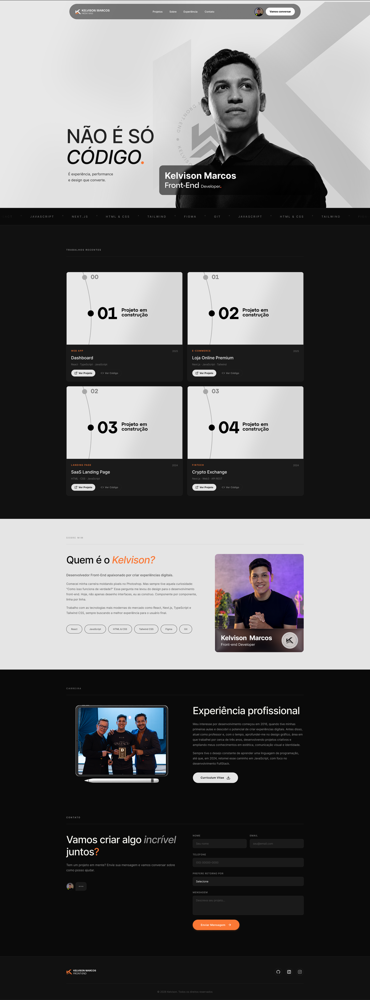
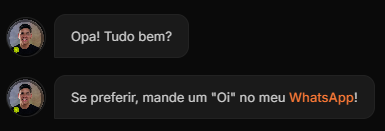

[](https://github.com/kelvimarcos/DevPortfolio/actions/workflows/ci.yml)

<br/>
<br/>

Este é o meu portfólio pessoal, desenvolvido como projeto full stack da minha formação em desenvolvimento web. Ele começou como um site estático e evoluiu <br/>
para uma aplicação completa: o front-end consome uma API própria para exibir os projetos e receber mensagens de contato, e um painel administrativo protegido <br/>
por login me permite gerenciar todo o conteúdo sem tocar no código.

<br/>
<br/>



<br/>
<br/>

---

<br/>
<br/>

## 🌐 Acesse o Projeto

Você pode visualizar o projeto diretamente pelo navegador:
<br/>
👉 **https://kelvimarcos.github.io/DevPortfolio/**
<br/>
- API: hospedada no Render (consumida pelo site)
- Painel administrativo: acesso restrito por login


<br/>
<br/>

---

<br/>
<br/>

## 💡 Insight

Em vez de editar HTML e fazer novo deploy toda vez que quero trocar um projeto ou revisar um texto, eu entro no meu próprio painel, altero e o site reflete na hora. <br/>
Além de resolver um problema real meu, o projeto demonstra o ciclo completo de uma aplicação web — interface, API, banco de dados, autenticação e deploy.


<br/>
<br/>

---

<br/>
<br/>


## 🎨 Design


- O projeto começou na criação da minha própria identidade visual e reflete perfeitamente o que quero transmitir. <br/>
- Tema escuro com destaque em laranja, tipografia Inter e hierarquia visual forte e fonte moderna. <br/>
- Hero com animação de entrada e faixa de tecnologias em movimento (marquee) <br/>
- Animações de revelação ao rolar a página <br/>
- Painel administrativo com identidade visual própria, alinhada à marca do site <br/>
- Layout responsivo para desktop, tablet e mobile


<br/>
<br/>

---

<br/>
<br/>


## 💻 Front-end

- HTML, CSS e JavaScript puro — sem frameworks <br/>
- Cards de projeto renderizados dinamicamente a partir da API (`fetch`) <br/>
- Formulário de contato com validação de campos e feedback visual de envio, erro e sucesso <br/>
- Cache local dos projetos (`localStorage`) para carregamento instantâneo em visitas repetidas <br/>
- Publicado no GitHub Pages


<br/>
<br/>

---

<br/>
<br/>


## ⚙️ Back-end

- API REST em Node.js com Express, organizada em rotas, controllers e middlewares <br/>
- PostgreSQL com Prisma (ORM, migrations e seed) <br/>
- Autenticação de administrador com bcryptjs e sessão em cookie persistida no banco <br/>
- Rotas privadas protegidas por middleware de autenticação <br/>
- Publicado no Render via Docker, com banco no Supabase <br/>


<br/>
<br/>

---

<br/>
<br/>


## 🚀 Funcionalidades

- Listagem dinâmica de projetos vinda do banco de dados <br/>
- Formulário de contato que grava as mensagens (nome, email, telefone, canal de retorno) <br/>
- Login de administrador com sessão segura <br/>
- Painel para criar, editar e excluir projetos <br/>
- Visualização e exclusão das mensagens recebidas, com vínculo ao projeto de interesse <br/>
- Menu mobile animado e navegação suave entre seções <br/>


<br/>
<br/>

---

<br/>
<br/>


## 🛠️ Tecnologias Utilizadas

HTML5 → Estrutura semântica <br/>
CSS3 → Estilização moderna (grid, flexbox, animações, responsividade) <br/>
JavaScript → Interatividade e consumo da API <br/>
Node.js + Express → API REST <br/>
PostgreSQL + Prisma → Banco de dados e ORM <br/>
bcryptjs + express-session → Autenticação e sessão <br/>
Docker → Container do back-end <br/>
GitHub Pages, Render e Supabase → Deploy <br/>
Jest + Supertest → Testes unitários e de integração da API <br/>
ESLint + Prettier → Padronização e qualidade do código <br/>
GitHub Actions → Integração contínua (CI) <br/>


<br/>
<br/>

---

<br/>
<br/>


## 📖 O que aprendi com este projeto

Construir uma API REST do zero e organizá-la em camadas <br/>
Modelar entidades relacionadas e trabalhar com migrations <br/>
Implementar autenticação com hash de senha e sessão em cookie <br/>
Lidar com CORS e cookies entre domínios diferentes (front e API em hospedagens separadas) <br/>
Fazer deploy de front-end estático e de container Docker <br/>
Integrar front-end e back-end de forma incremental, sem quebrar o que já funcionava <br/>


<br/>
<br/>

---

<br/>
<br/>


## ▶️ Rodando localmente

Pré-requisitos: Node.js e PostgreSQL instalados, com um banco criado.

**1. Back-end (API)**

```bash
cd backend
npm install
cp .env.example .env
```

Preencha o `.env` com a sua `DATABASE_URL`, um `SESSION_SECRET` e os dados do administrador (`ADMIN_EMAIL` e `ADMIN_PASSWORD`). Depois:

```bash
npx prisma migrate dev
npm run seed
npm run dev
```

A API sobe em `http://localhost:3333`.

**2. Front-end**

Abra a pasta `front-end` com um servidor local (por exemplo, a extensão Live Server do VS Code). <br/>
Quando o site roda em `localhost`, o arquivo `front-end/js/config.js` aponta automaticamente para a API local. <br/>
O endereço do front precisa estar liberado na variável `CORS_ORIGIN` do `.env` (o exemplo usa `http://localhost:5501`).

**3. Painel administrativo**

Acesse `admin/login.html` e entre com o email e a senha definidos no `.env`.


<br/>
<br/>

---

<br/>
<br/>


## ⚠️ Observações Importantes

O deploy da API foi feito no Render.


<br/>
<br/>

---

<br/>
<br/>


### 📱 Interação de chat

Um detalhe de usabilidade que gosto de destacar: na seção de contato, simulei uma conversa real de mensageiro. Primeiro aparece o indicador de "digitando..."  <br/> 
e, em seguida, a mensagem chega como se eu estivesse falando com o visitante naquele momento. É um toque pequeno, mas aproxima a experiência de algo humano e convida <br/>
a pessoa a iniciar a conversa.

| Digitando... | Mensagem recebida |
|---|---|
|  |  |


<br/>
<br/>

---

<br/>
<br/>


## 🧭 Usabilidade

O projeto nasceu no wireframe abaixo, onde defini a estrutura das seções antes de partir para o design e o código:


<br/>
<br/>

---


## 🔍 Qualidade de código

O projeto passou por um diagnóstico de qualidade e por uma refatoração com foco em Clean Code (nomes descritivos, extração de funções, remoção de duplicação e tratamento de erros com log). <br/>
Os problemas encontrados, a complexidade ciclomática e as correções aplicadas estão documentados em [DIAGNOSTICO.md](DIAGNOSTICO.md).


<br/>
<br/>

---


## 🧪 Testes e qualidade

A API tem testes automatizados com **Jest** e **Supertest**, que rodam sem banco de dados (o Prisma é simulado nos testes):

- **Testes unitários** (`backend/tests/unit`) → controllers, middlewares e utilitários, cobrindo o caminho feliz e casos de erro (campos obrigatórios, registro inexistente, senha errada, erro interno sem vazar detalhes). <br/>
- **Teste de integração** (`backend/tests/integration`) → requisições HTTP reais ao app, passando por rotas, autenticação, controllers e tratamento de erros. <br/>
- **Cobertura mínima de 60% das linhas** em `backend/src`, verificada automaticamente. <br/>

Comandos, dentro da pasta `backend`:

```bash
npm test                # roda os testes
npm run test:coverage   # testes + relatório de cobertura (falha abaixo de 60%)
npm run lint            # ESLint
npm run format:check    # verifica a formatação com Prettier
npm run format          # aplica a formatação
```

A cada push e pull request, o **GitHub Actions** ([ci.yml](.github/workflows/ci.yml)) executa lint, verificação de formatação e testes com cobertura.


<br/>
<br/>

---


## 📌 Próximos Passos

Adicionar meus projetos pessoais. <br/>
Melhora do UX do chat para melhor conversão. <br/>
Upload de imagem direto pelo painel (ex: Supabase Storage) <br/>
Notificação por email quando uma nova mensagem chegar <br/>
Monitoramento da API para evitar a hibernação do plano gratuito <br/>
Filtro de projetos por categoria na página inicial <br/>
